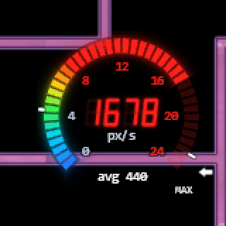

# wkSpeedometer

A WormKit module for **Worms Armageddon 3.8.1** that shows how fast your worm goes: a speedometer for the worm whose
turn it is, and an optional movement line that shows where that worm has been. It was split out of
[wkMapZoom](https://github.com/GermsWorms/wkMapZoom) (which had both up to 4.3), so you can have the speedometer
without the zoom.

> **Version 1.2 is a beta.** It has been tested on replays in a window on one PC, alone and together with wkMapZoom 6.
> If something goes wrong, please [open an issue](https://github.com/GermsWorms/wkSpeedometer/issues) with the log
> (see Notes).

<a href="screenshots/speedometer.png"></a>

*The dial in the middle of a big jump, at 1678 px/s (shown larger than in the game; click it for the whole screen).*

## What it does

- **Speedometer** (on by default). The speed of the worm whose turn it is, in pixels a second, as a see-through
  digital dial: a ring lit up to the speed, blue when slow, through cyan, green, yellow and orange, red from 800 px/s
  on (`RedFrom`). The number takes the same colour. The dial also shows the turn's best (one lit segment) and its
  average (a white mark and "avg"). WA caps a worm's speed at 1600 px/s straight down or across and 2263 px/s
  diagonally (MAX on the dial). You can show the number alone instead of the dial (`Speedometer=number`), and put it
  just above the worm's name instead of the bottom right corner (`SpeedometerPlace=worm`).
- **Movement line** (off by default: `TurnLine=all` or `TurnLine=last`). When a worm's turn starts, a line shows where
  that worm has been: its last turn bright, fading in toward where it stopped (so you can see which way it was
  going), and with `all` everything else dimmer (its earlier turns, and being knocked about in other turns, so the line
  always ends at the worm). It goes as soon as the worm moves, or stays all turn with `TurnLineKeep=1`. It is coloured
  by how fast the worm went there, in the speedometer's colours, or all red (`TurnLineColour=red`). It follows the worm
  itself, so teleports are not drawn.

Both are drawn over the HUD, and never while WA's Esc menu is open.

## Install

1. Download `wkSpeedometer.dll` (and, if you want to change the settings, `wkSpeedometer.ini`) from
   [`release/`](release/) and put them in your Worms Armageddon folder, next to `WA.exe` (Steam: `...\steamapps\common\Worms Armageddon`; GOG: usually
   `C:\Program Files (x86)\GOG Galaxy\Games\Worms Armageddon` or `C:\GOG Games\Worms Armageddon`). WA must be 3.8.1
   (the version is shown at the bottom of WA's main menu).
2. In WA: **Options > Advanced >** tick **Load WormKit modules**.
3. Start a game.

Uninstall: delete `wkSpeedometer.dll`, or set `Enabled=0` in `wkSpeedometer.ini`.

## Works with (all optional)

- **[wkMapZoom](https://github.com/GermsWorms/wkMapZoom)** (6 or newer). When it is loaded, two things change:
  - The dial and the line are drawn by the graphics card over the finished picture: smooth and see-through, in true
    colour. (wkMapZoom draws WA's picture on the graphics card and lets other modules draw over it. That needs WA's
    Graphics API on Direct3D 9 (shader).)
  - The line and the dial above the worm follow the zoomed map.

  Without it (or on a frame the graphics card doesn't draw) they go into WA's own 256-colour frame, at WA's normal
  100% view: the dial in the nearest colours of WA's palette, the line as solid pixels with the dimmer parts thinned
  out by a dither pattern. That works with every one of WA's Graphics APIs.

  Keep wkMapZoom's file name as it is: the module looks for `wkMapZoom.dll`. Don't use it with wkMapZoom 4.3 or
  older: those have their own speedometer and movement line (you would see two of each) and don't tell their zoom.
- **[wkModMenu](https://github.com/GermsWorms/wkModMenu).** With it the settings below can be changed in the game
  (Esc, Mods), and from 1.1 they apply at once.

## Settings (`wkSpeedometer.ini`, all optional)

| Key | Default | |
|---|---|---|
| `Enabled` | `1` | 0 = the module does nothing |
| `Speedometer` | `dial` | `dial` (a digital gauge), `number` (the number alone) or `off` |
| `SpeedometerPlace` | `corner` | `corner` (bottom right, above WA's wind bar) or `worm` (just above the worm's name) |
| `RedFrom` | `800` | the speed, in pixels a second, where the colours reach red (50 to 5000) |
| `TurnLine` | `off` | the movement line at a turn's start: `all` (the whole game, its last turn bright), `last` (its last turn only), `off` |
| `TurnLineKeep` | `0` | 1 = the line stays all turn; 0 = it goes once the worm moves |
| `TurnLineColour` | `speed` | `speed`: coloured by how fast the worm went there; `red`: all red |

## Notes

- **WA 3.8.1 only, Steam or GOG.** The module checks `WA.exe` (Steam's file, or any other whose game code is 3.8.1's
  byte for byte, as GOG's is) and does nothing on any other version; the log says which it found.
- **It only reads the game.** Nothing in the game changes, so online games and replays stay in sync, and other players
  don't need the module. It only draws on your own screen.
- The speed is the speed of the worm whose turn it is, as the game has it (WA moves things 50 times a second; walking
  is measured from the worm's path). In replays it shows the worm of the turn being played back.
- The movement line is per worm: each of a team's worms has its own, shown at that worm's turns. It is kept for the
  whole game and starts again with the next game.
- In real-time play (wkRealTime), where several worms have the turn at once, there is no speedometer and no line.
- WA's own screenshots show the dial and the line only when they went into WA's frame (without wkMapZoom). Laid over
  the picture by the graphics card, they are on your screen but not in WA's screenshot.
- Keep one copy of the module in the WA folder (a renamed second copy finds the first one and does nothing).
- Once WA has loaded it, the module stays loaded until WA exits. A new `wkSpeedometer.dll` takes effect at WA's next
  start.
- Log: `%LOCALAPPDATA%\wkSpeedometer\wkSpeedometer.log` (send it along with WA's `ERRORLOG.TXT` if WA crashes).

## How it works

WA's team tasks are seen through their message handler, and the worms through their physics step: both hooks only
look. Each frame the module notes which team has the turn, where its current worm is and how fast it goes, and every
worm's place for the movement line (every 2 pixels it moves). Right after WA has drawn its frame's drawing queue (the
map and the HUD), the line and the speedometer are drawn on top: by the graphics card when wkMapZoom is there and
draws this frame, else into WA's 8-bit frame. Where the map is on the screen comes from wkMapZoom when it tells, else from WA's
camera.

Hooks (WA 3.8.1, checked by the SHA-256 of `WA.exe`, or of its code section with its sections where 3.8.1 has them,
and the original bytes at each hook point): `00533DC0` GameRender, `00542350` RenderDrawingQueue, `00557310` a team
task's message handler and `004FCDF0` an object's physics step. Other modules (wkMapZoom, wkWAI) hook some of the same
functions: when another module's hook is already there, this one chains onto it, and keeps that module loaded.

## Building

Needs a 32-bit MinGW gcc (for example `C:\MinGW\bin\gcc.exe`) and PowerShell:

```powershell
.\build.ps1                 # runs the tests, then builds wkSpeedometer.dll
.\install.ps1               # copies it into the Steam or GOG WA folder (-Game <folder> for another one)
.\install.ps1 -Remove
```

The tests: the speedometer's pictures (`speedo_test`: every size and speed painted with guard words; with a folder it
writes them out to look at), and the drawing code (`draw_test`: the movement line's segments and triangles, and the
line, the dial and the number drawn into a made-up 8-bit frame with a made-up palette).

## Credits and licence

- Split out of [wkMapZoom](https://github.com/GermsWorms/wkMapZoom) 4.3 beta 2 (MIT, the same author): the speedometer, the movement
  line and the way the turn's worm is found are ported from there.
- [MinHook](https://github.com/TsudaKageyu/minhook) (BSD 2-clause), in `third_party/minhook`.
- wkSpeedometer is MIT licensed: see [LICENSE](LICENSE), and [THIRD_PARTY_NOTICES.md](THIRD_PARTY_NOTICES.md).
